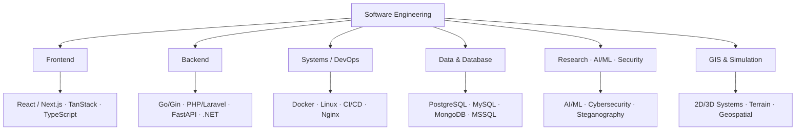

<!-- ============================================================= -->
<!--  SHEIKH THANBIR ALAM · Portfolio README                       -->
<!-- ============================================================= -->

<div align="center">

<!-- Optional: animated typing banner -->


# 👨‍💻 SHEIKH THANBIR ALAM

### Senior Software Engineer · Full-Stack Engineer · Researcher

**Independent Contractor @ Apple Inc.** &nbsp;•&nbsp; **PhD Student @ Universiti Malaysia Perlis**

<p>
  <a href="https://thanbirtamim.github.io/"></a>
  <a href="https://thanbirtamim.github.io/blog/"></a>
  <a href="https://github.com/ThanbirTamim"></a>
  <a href="mailto:sk.tamim56@gmail.com"></a>
</p>

<p>
  
</p>

</div>

> Building scalable software, enterprise systems, cloud-native applications, AI/ML solutions,
> cybersecurity systems, GIS simulations, and research-driven technologies.

---

## 🧑‍💻 About Me

I am a **Full-Stack Software Engineer** with deep experience designing and developing
scalable web applications, enterprise software, backend systems, GIS-based simulation
platforms, and mission-critical software.



---

## 🏢 Professional Experience

<table>
  <tr>
    <td width="60" align="center">🍎</td>
    <td>
      <b>Independent Contractor — Apple Inc.</b><br/>
      <sub>Jul 2026 – Present · Remote</sub><br/>
      Contributing to Apple product development · designing scalable software components ·
      collaborating with cross-functional teams · upholding high standards of code quality,
      performance, and reliability.
    </td>
  </tr>
  <tr>
    <td align="center">💻</td>
    <td>
      <b>Senior Software Engineer — Softzino Technologies</b><br/>
      <sub>May 2026 – Present · Hybrid</sub><br/>
      Full-stack & enterprise solutions with React/Next.js, TanStack, Tailwind, Go/Gin,
      PHP/Laravel, PostgreSQL/MySQL/MongoDB, Docker & CI/CD.
    </td>
  </tr>
  <tr>
    <td align="center">🎖️</td>
    <td>
      <b>Senior Software Programmer — Bangladesh Army</b><br/>
      <sub>Sept 2020 – May 2026 · Onsite (Army War Game Centre)</sub><br/>
      2D/3D GIS gaming simulation · military & UN peacekeeping simulation · constructive
      disaster & fire-service simulation · procedural 3D terrain generation · geospatial
      data processing · GIS programming · server & database management.
    </td>
  </tr>
  <tr>
    <td align="center">🔐</td>
    <td>
      <b>Research Programmer — Cyber Security Center, Daffodil International University</b><br/>
      <sub>Jun 2019 – Sept 2020 · Onsite</sub><br/>
      Cybersecurity research · security solution development · data security & system
      protection · security protocols · secure software development · training & workshops.
    </td>
  </tr>
</table>

---

## 🛠️ Tech Stack

**Languages**


**Frontend**


**Backend**


**Databases**


**DevOps & Infrastructure**


> ℹ️ Badges represent **relative technology familiarity / usage areas** from the portfolio —
> not measured GitHub percentages. For exact figures, use GitHub repository statistics.

---

## 🌍 GIS & Simulation

A significant part of my engineering experience comes from **GIS and simulation systems**.

| Domain | Work |
|---|---|
| 🗺️ Simulation | 2D & 3D simulation systems |
| 🏔️ Terrain | Procedural + real-world terrain generation |
| 📡 Geospatial | Real-world data processing & geospatial analysis |
| 🎖️ Military | Training, UN peacekeeping & disaster simulation |

---

## 🤖 AI / ML & Research

```text
Artificial Intelligence · Machine Learning · Medical Image Processing
Steganography · Cryptography · Cybersecurity · Privacy-Preserving Systems
```

My research combines software engineering, AI, image processing, information security,
and data-hiding techniques.

### 📚 Publications &nbsp;·&nbsp; 🏆 Best Presenter Award (APCT 2026)

IEEE / Scopus-indexed publications covering:

- Deep neural steganography
- Medical ultrasonogram video security
- Modern steganography security challenges
- AI-guided video steganography
- Edge-detection & DWT-based video steganography
- LSB-based image steganography
- Cryptography & secure information hiding

---

## 🚀 Selected Projects

| Project | Technology |
|---|---|
| Real-World Heightmap Generation | .NET Core · Python · Shell |
| Parallel Complex Line Creating | .NET Framework · DotSpatial |
| Video Steganography | C# · FFmpeg · Shell · MATLAB |
| AI Food Order System | Laravel · JS · MySQL |
| Live Search for E-Commerce | Laravel · AJAX · MySQL |
| FTP Server | .NET Framework · MSSQL |
| Teacher Appointment System | Laravel · JS · MySQL |

---

## 🎓 Education

| Degree | Field | Institution | Result | Year |
|---|---|---|---|---|
| **PhD** | Computer Engineering | Universiti Malaysia Perlis (UniMAP), Malaysia | Ongoing | — |
| **MSc** | Software Engineering — Cyber Security | Daffodil International University | 3.98 / 4.00 | 2022 |
| **BSc** | Software Engineering | Daffodil International University | 3.99 / 4.00 | 2019 |
| **HSC** | Science | Birshresta Noor Mohammad Public College | 5.00 / 5.00 | 2014 |
| **SSC** | Science | Natore Sugar Mills High School | 5.00 / 5.00 | 2012 |

---

## 🏅 Certifications

- **Certified Ethical Hacker (CEH)** — EC-Council · 2020
- **Mobile Forensic** — Cyber Security Center, DIU · 2021
- **Digital Security** — ICT Division, Bangladesh · 2021

---

## 📖 Teaching & Knowledge Sharing

- **LDP — Logic Development Program**
- **YouTube:** Encryption Tutorial · PHP CRUD Operation Tutorial
- **Blog:** in-depth Bangla & English engineering guides → [thanbirtamim.github.io/blog](https://thanbirtamim.github.io/blog/)

---

## 🌟 What I Build

```text
✓ Scalable Web Applications      ✓ Cloud-Native Applications
✓ Enterprise Software            ✓ AI/ML Systems
✓ REST APIs                      ✓ Cybersecurity Solutions
✓ Backend Services               ✓ GIS & 2D/3D Simulation Systems
✓ Geospatial Applications        ✓ Medical Image Processing Systems
✓ Research Prototypes
```

---

## 📊 GitHub Stats

<div align="center">


<br/>


</div>

> **Note:** The *Top Languages* card above is generated live from GitHub repositories, so the
> percentages stay technically accurate automatically.

---

## 📫 Contact

<p>
  <a href="mailto:sk.tamim56@gmail.com"></a>
  <a href="https://thanbirtamim.github.io/"></a>
  <a href="https://github.com/ThanbirTamim"></a>
</p>

---

<div align="center">

### _"Build. Research. Engineer. Innovate."_

**— Thanbir Alam**

<sub>© 2025 Sheikh Thanbir Alam · All Rights Reserved</sub>

</div>
